# FPGA-Based General-Purpose DNN Accelerator

A SystemVerilog accelerator for fully connected deep neural network inference, built around a parameterized 3D systolic array. An instruction set describes layer operations and matrix dimensions, allowing the accelerator to execute networks with different layer counts and neuron counts within its hardware and memory limits.

The project covers the complete development flow: a PyTorch model, an independent Python inference reference, hardware architecture, RTL verification, and FPGA deployment. The demonstrated application is MNIST handwritten digit classification.

## Features

- Parameterized systolic array with configurable rows, columns, and depth.
- Pipelined processing elements for multiply-accumulate operations.
- Instruction-controlled matrix multiplication, bias addition, activation, right shifting, and argmax.
- Configurable matrix addresses and dimensions for each operation.
- DMA-based data movement, SRAM, and operand buffering.
- SystemVerilog simulation using initialized data and instruction memories.
- FPGA integration with the Zynq processing system through AXI SmartConnect.

## Development Approach

1. **Build the software model.** Implement a neural network in Python using PyTorch and obtain its trained parameters.
2. **Create an independent inference reference.** Implement the forward-pass equations directly in Python without PyTorch, using the same weights and biases.
3. **Check numerical agreement.** Compare the reference implementation's outputs with the PyTorch outputs before designing the hardware.
4. **Design the architecture.** Map the validated operations to a systolic array, bias adder, activation logic, and memory system.
5. **Implement and verify the RTL.** Translate the schematic architecture into SystemVerilog and exercise the design using a verification environment.
6. **Deploy on FPGA.** Integrate the accelerator with the Zynq processing system and external DDR memory.

### Software Reference and Validation

The independent Python reference expresses the layer computations directly with NumPy. The illustrated network applies ReLU after the first two layers and leaves the final layer as a linear output for classification.

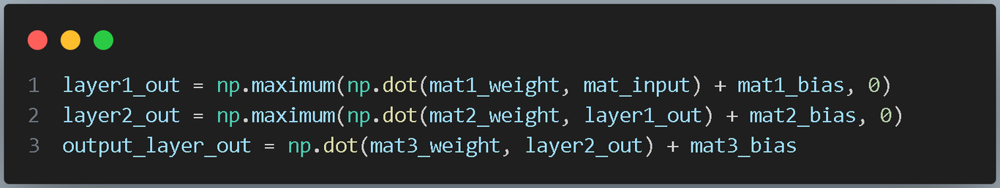

*The reference applies the trained weight and bias tensors layer by layer, providing expected numerical outputs before the hardware implementation.*

View the software comparison output

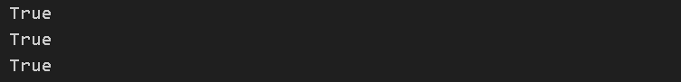

The presentation shows three successful comparison results during the reference-validation step. This records the demonstrated comparison, rather than a dataset-wide accuracy measurement.

## Computation

For a layer using ReLU, the forward pass is:

$$
Y = \operatorname{ReLU}(WX + b)
$$

Here, $X$ is the input vector or matrix, $W$ is the weight matrix, $b$ is the bias vector, and $Y$ is the layer output. Biases are applied to the corresponding outputs. ReLU computes $\max(0, x)$ elementwise.

The hardware separates these operations into matrix multiplication, bias addition, optional right shifting, and an activation or argmax stage selected by the instruction.

## Hardware Architecture

### System Schematic

The schematic shows how the controller coordinates memory transfers and computation. Operands move from DRAM through the global DMA into SRAM, then through buffers into the systolic array. The remaining datapath includes result extraction, shifting, bias addition, ReLU, and argmax, with control and completion signals coordinating the stages.

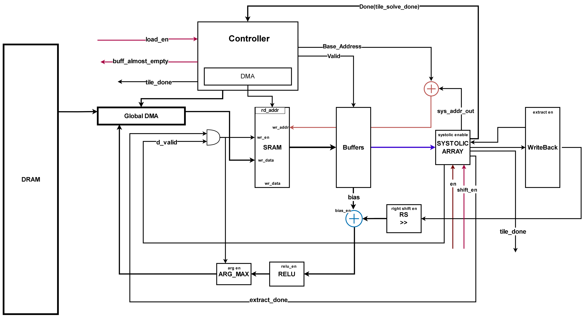

*System schematic from the presentation. Follow the signal labels for the detailed connections between blocks. The instruction selects which processing stages are enabled.*

### Main Blocks

| Block | Role |
| --- | --- |
| Controller | Coordinates operation execution and data movement |
| Global and local DMA | Transfer operands and results through the memory system |
| DRAM interface | Provides access to stored data |
| SRAM and buffers | Stage operands for computation |
| Systolic array | Performs pipelined matrix multiplication using interconnected processing elements |
| Bias adder | Adds bias values to multiplication results |
| Right shifter | Applies instruction-selected shifting |
| ReLU | Applies the activation function |
| Argmax | Selects the index of the largest output for classification |
| Writeback logic | Stores computed results |

The systolic array's rows, columns, and depth are hardware parameters. Network operations and matrix dimensions are supplied through instructions. These provide separate ways to configure the hardware structure and the workload it executes.

### Processing Elements and Systolic Array

A **processing element (PE)** is the repeated compute unit in the systolic array. PEs perform multiply-accumulate work, contributing products and accumulated sums to matrix multiplication. The figures below show how the presentation builds up the array from this unit.

| Single PE | Connected PEs in a row |
| --- | --- |
|  | 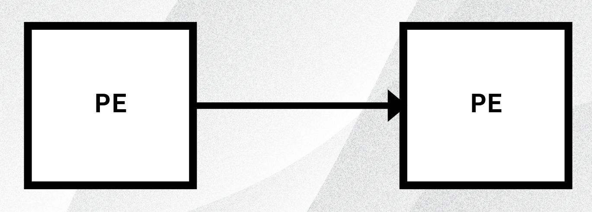 |
| The repeated compute block. The slide uses a block symbol rather than showing its internal multiplier, adder, and registers. | Neighboring PEs form a row, illustrating one direction of the pipelined array. |

| Rows and columns | Configurable depth |
| --- | --- |
| 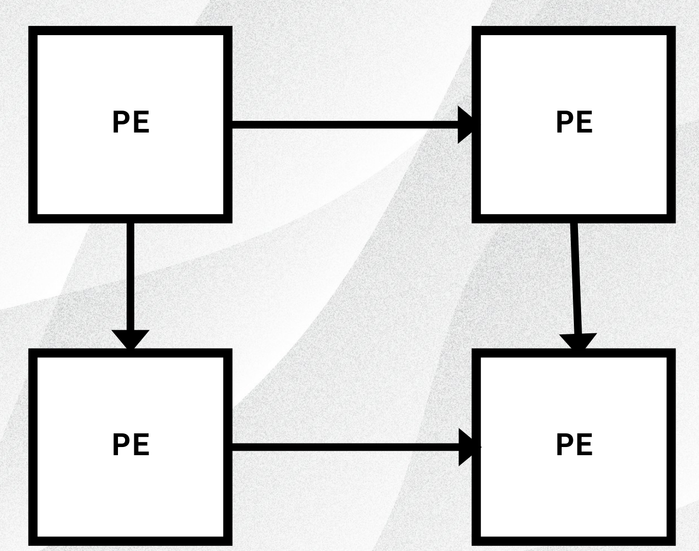 | 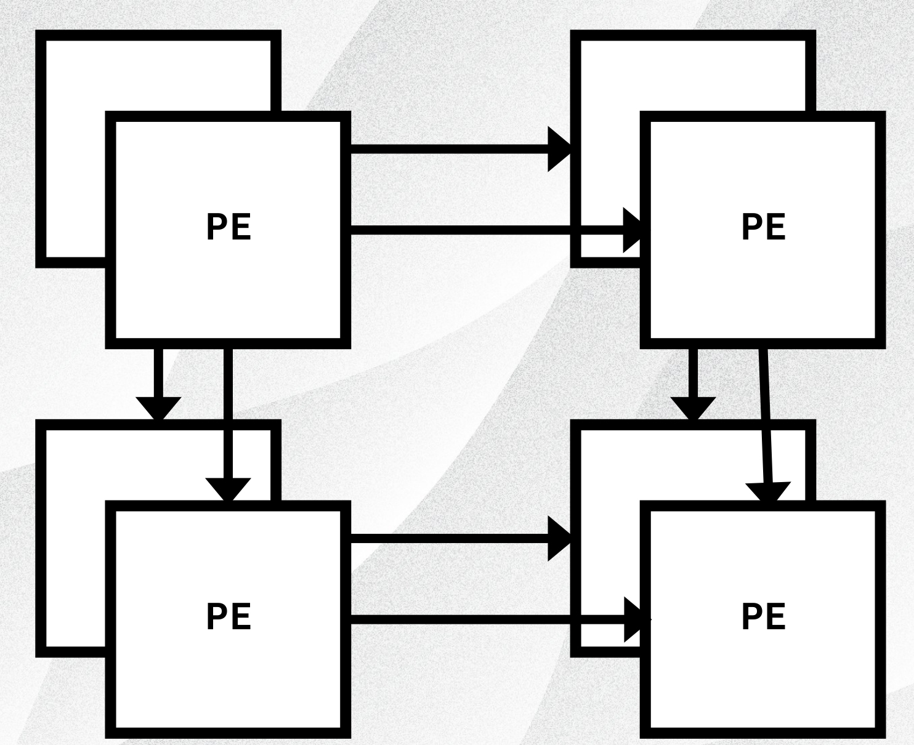 |
| Vertical connections extend the row into an illustrative 2 × 2 array. | An offset plane of PEs illustrates the additional depth dimension of the parameterized 3D array. |

*These figures illustrate connectivity, rather than cycle-by-cycle timing. They show the architecture's configurability. The demonstrated testbench configuration below uses `ROWS = 2`, `COLS = 2`, and `DEPTH = 1`.*

### RTL Module Hierarchy

The top-level `dnn_top` groups the local DMA, SRAM, pipelined DNN datapath, global DMA, and DRAM controller. The pipelined datapath contains the systolic array and the post-processing blocks used by the instruction set.

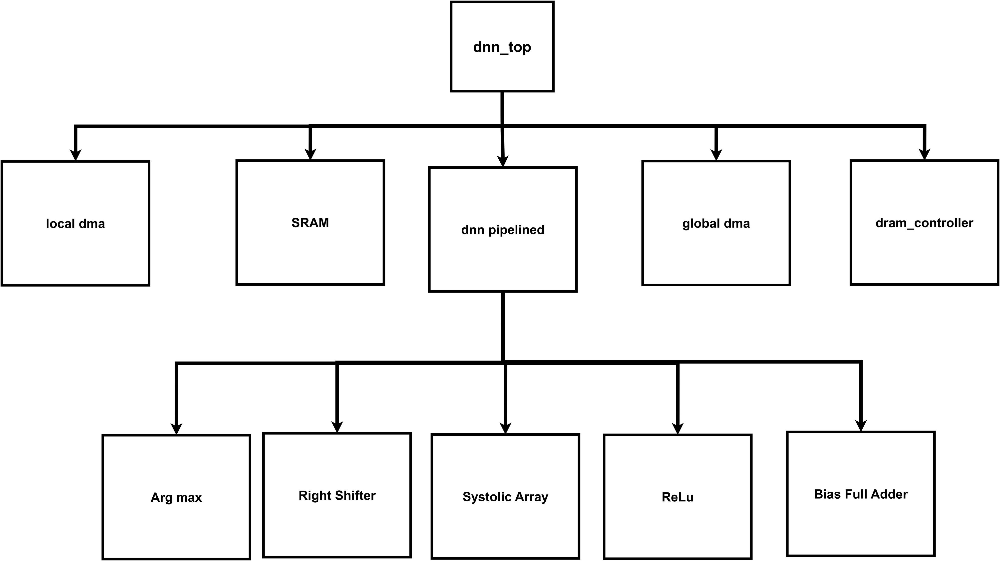

*Module hierarchy from the presentation. The tree shows structural containment rather than the direction of data transfers.*

## Instruction Set

The presentation defines the following operation codes:

| Operation code | Operation sequence |
| --- | --- |
| `001` | Matrix multiplication → bias addition |
| `010` | Matrix multiplication → bias addition → activation |
| `011` | Matrix multiplication → bias addition → right shift → activation |
| `100` | Matrix multiplication → bias addition → right shift → argmax |
| `101` | Matrix multiplication → bias addition → argmax |
| `110` | Matrix multiplication → argmax |

The activation used in the demonstrated datapath is ReLU.

Each instruction supplies the addresses and dimensions needed for its operation:

| Field | Meaning |
| --- | --- |
| `a_base_addr` | Base address of matrix A |
| `b_base_addr` | Base address of matrix B |
| `bias_base_addr` | Base address of the bias data |
| `dest_addr` | Destination address for the result |
| `rows_in` | Number of output rows |
| `cols_in` | Number of output columns |
| `common_in` | Shared inner dimension of the matrix multiplication |
| `op` | Operation selection |

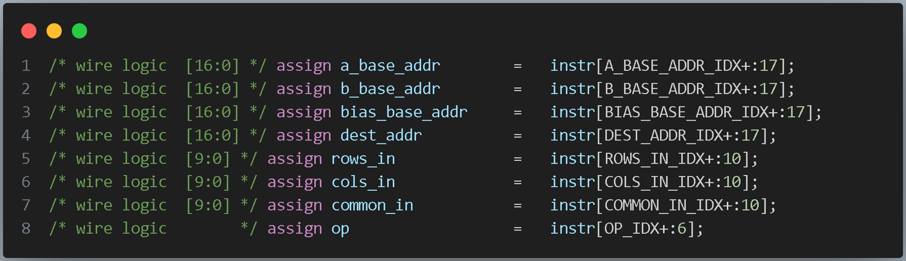

The opcode table shows the operation values as presented. The RTL excerpt extracts a six-bit `op` field, so the three-bit labels above should not be treated as a complete instruction encoding specification.

## Verification

The verification flow uses a simulated DRAM module and a separate instruction memory:

1. Load the trained weights, biases, and input data from a DRAM initialization file into the simulated DRAM.
2. Load the operation sequence from an instruction initialization file into instruction memory.
3. Run the accelerator and observe the computed outputs in QuestaSim.
4. Compare the outputs against the expected reference results for the selected scenario.

### Data and Instruction Memories

The data-memory initialization file places weights and biases in separate regions. Instructions identify these regions through base-address fields, keeping the data layout separate from the selected arithmetic operation.

*Example layout from the presentation: the first layer stores a 100 × 784 weight matrix and a 100 × 1 bias vector. The second layer stores a 50 × 100 weight matrix and a 50 × 1 bias vector. These dimensions belong to the demonstrated workload.*

The instruction-memory initialization file supplies the sequence of encoded operations. Each instruction selects the operands, dimensions, destination, and processing stages described in the instruction-set section.

View the instruction-memory example

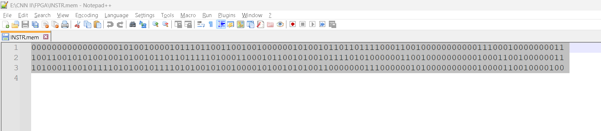

*The presentation's `INSTR.mem` example contains three binary instruction words. Use the RTL field definitions to decode them.*

### Demonstrated Testbench Configuration

| Parameter | Value |
| --- | --- |
| `STRESS` | Enabled |
| `CORES` | 2 |
| `ROWS` | 2 |
| `COLS` | 2 |
| `DEPTH` | 1 |
| `WIDTH` | 32 bits |
| `FRACTION_BITS` | 12 bits |
| `PARAM_WIDTH` | 18 bits |
| `DIMENSION_WIDTH` | 10 bits |
| `DRAM_DEPTH` | 85,020 |
| `SRAM_DEPTH` | 32 |
| `BIAS_MEM_DEPTH` | 128 |
| `BUFF_DEPTH` | 5 |
| `ARG_COUNT` | 10 |
| `BASE_ADDR` | `0x00100000` |

These values describe the simulation example shown in the presentation.

### MNIST Example

The demonstrated input is a **28 × 28 image of the digit 5**. The simulation waveform shows the final `predict` signal as `32'h00000005`, matching the input label.

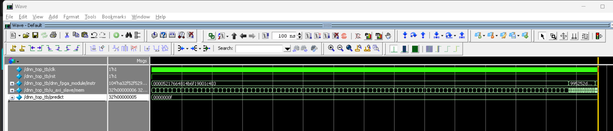

This example demonstrates a successful inference. The presentation does not report dataset-wide hardware accuracy, latency, throughput, power consumption, or FPGA resource utilization.

## FPGA Integration

The FPGA block design connects the accelerator's AXI master interface to the Zynq processing system's `S_AXI_GP0` interface through AXI SmartConnect. The processing system provides access to external DDR memory. The design also includes processor-system reset logic, button inputs, and LED outputs.

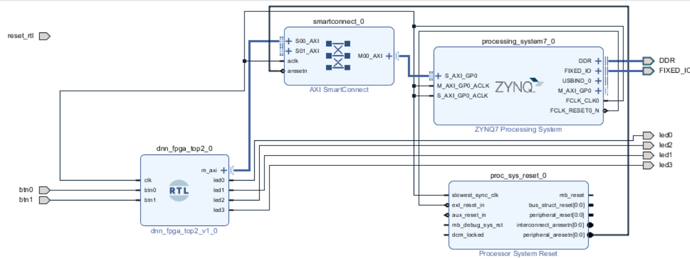

## Tools and Languages

| Tool or language | Use |
| --- | --- |
| Python and PyTorch | Software model and inference validation |
| Python | Independent mathematical reference implementation |
| SystemVerilog | Accelerator RTL and simulation environment |
| QuestaSim | RTL simulation and waveform inspection |
| Vivado | FPGA block design and integration |

## Running the Project

Simulation requires the RTL sources, testbench, DRAM initialization file, and instruction initialization file. Configure the memory-file paths for your local checkout, compile the design and testbench in the required dependency order, and run the MNIST scenario in QuestaSim.

FPGA deployment additionally requires the target-specific project, constraints, and memory initialization setup. Exact compile commands, source-file order, and deployment steps depend on the accompanying repository files.
